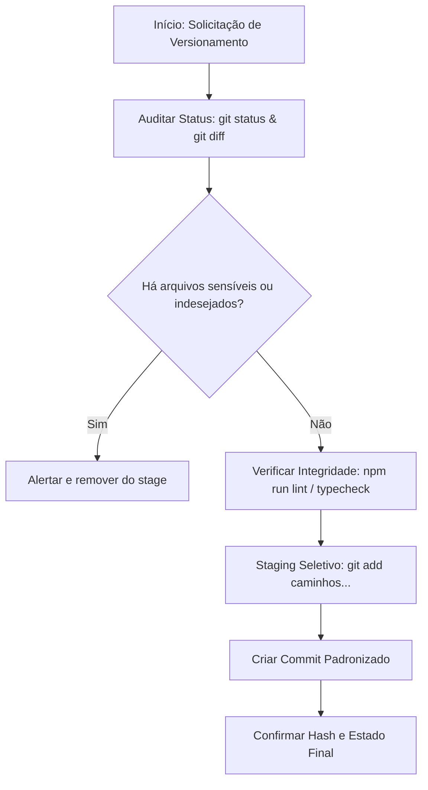

# Git Manager — Governança de Commits e Branches

Esta skill define os padrões e procedimentos mecânicos para gerenciar commits, branches e o ciclo de versionamento do projeto **qr-order**.

## 1. Padrões de Branches

As branches devem sempre seguir o formato:
`<tipo>/<nome-curto-descritivo-em-kebab-case>`

| Tipo        | Finalidade                                       | Exemplo                                     |
| :---------- | :----------------------------------------------- | :------------------------------------------ |
| `feat/`     | Nova funcionalidade ou história de usuário       | `feat/cardapio-digital`, `feat/auth-alias`  |
| `fix/`      | Correção de defeito ou bug                       | `fix/carrinho-total`, `fix/sessao-expirada` |
| `refactor/` | Reestruturação de código sem alteração funcional | `refactor/controllers-para-services`        |
| `test/`     | Adição ou reestruturação de testes               | `test/cobertura-pedidos`                    |
| `docs/`     | Documentação, ADRs, manuais                      | `docs/fluxo-pedidos-adr`                    |
| `chore/`    | Configurações, dependências, build               | `chore/atualiza-adonis-v6`                  |
| `hotfix/`   | Correção emergencial para ambiente produtivo     | `hotfix/vazamento-memoria-sse`              |

### Regras de Criação de Branch:

- Toda branch de trabalho deve nascer a partir da `main` sincronizada:
  ```bash
  git checkout main
  git pull origin main
  git checkout -b feat/minha-feature
  ```
- Mantenha a branch atualizada com a `main` frequentemente:
  ```bash
  git fetch origin
  git rebase origin/main
  ```

---

## 2. Padrão de Commits (Conventional Commits em Português)

O repositório adota commits atômicos com mensagens em português claro no presente do indicativo:

```text
<tipo>: <descrição sucinta em português minúsculo>

[corpo opcional detalhando o porquê da mudança]
```

### Exemplos Válidos:

- `feat: cria e configura specs, tasks e testes para os módulos`
- `feat: adiciona autenticação por alias no cardápio`
- `fix: corrige cálculo de taxa de entrega no carrinho`
- `docs: atualiza adr sobre arquitetura deep modules`
- `test: adiciona testes unitários para o modelo de usuário`
- `refactor: extrai validação de pedido para formulário dedicado`
- `chore: instala e configura dependências do vite`

### Regras de Ouro para Commits:

1. **Atômico**: 1 responsabilidade lógica por commit.
2. **Nunca comitar código quebrado**: O código deve passar em lint e typecheck antes de comitar.
3. **Nunca usar `git add .` às cegas**: Adicione os arquivos por contexto (`git add app/models/...`).
4. **Zero credenciais/lixo**: Nunca comitar `.env`, arquivos temporários (`tmp/`), `.DS_Store` ou logs.

---

## 3. Fluxo de Execução do Git Manager

Ao receber uma solicitação de commit ou gestão de branches:



### Passo a Passo:

1. **Auditoria Prévia**:
   ```bash
   git status
   git diff --stat
   ```
2. **Verificação de Qualidade**:
   ```bash
   npm run lint
   npm run typecheck
   ```
3. **Staging e Commit**:
   ```bash
   git add <arquivos-específicos>
   git commit -m "tipo: mensagem descritiva"
   ```
4. **Relatório**:
   Informe ao usuário o commit gerado (`git log -n 1 --stat`) e a branch atual.

---

## 4. Salvaguardas e Segurança

- **PROIBIDO**: `git push --force` sem pedido expresso do usuário.
- **PROIBIDO**: `git reset --hard` ou descarte de alterações não salvas sem confirmação explícita.
- **PROIBIDO**: Modificar branches protegidas (`main`) diretamente quando houver política de PR.
